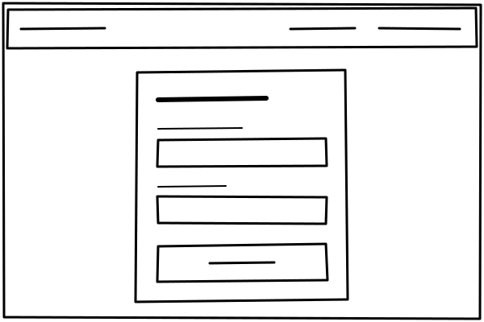
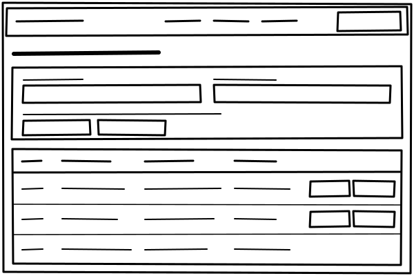
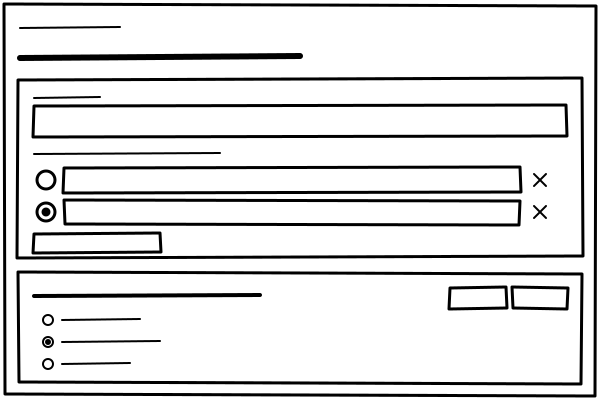
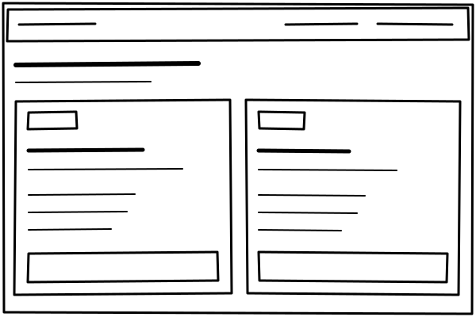
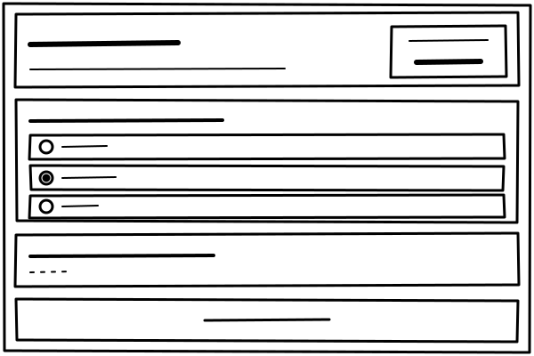
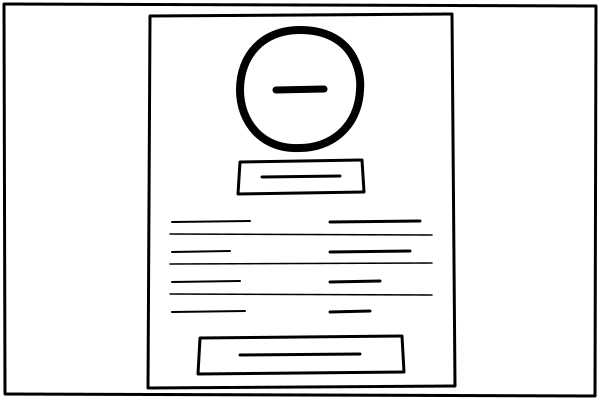

# Acme School

Una pagina web para hacer examenes en linea. Los profes y administrativos crean los examenes, y los estudiantes los presentan con un reloj corriendo.

Esta hecha solo con HTML, CSS y JavaScript, nada de frameworks. Cada pantalla es un Web Component y todo se guarda en el LocalStorage del navegador.

---

## Que se puede hacer

**Si eres profe o administrativo** (tienes que iniciar sesion):
- Crear, editar y borrar usuarios.
- Crear, editar y borrar examenes.
- Meterle preguntas a cada examen, cada una con varias respuestas y solo una correcta.

**Si eres estudiante** (no necesitas cuenta):
- Ver los examenes disponibles.
- Poner tu identificacion y nombre, y presentar el examen.
- Ver tu nota al final: cuantas sacaste bien, el porcentaje y si pasaste o no.

---

## Como se ve

Unos bocetos de las pantallas principales.

**Login**



**Gestion de usuarios**



**Preguntas de un examen**



**Examenes disponibles (estudiante)**



**Presentando el examen**



**Resultado**



---

## Como abrirlo

1. Descarga o clona el repo.
2. Abrelo en VS Code.
3. Instala la extension **Live Server**.
4. Clic derecho en `index.html` y dale a **Open with Live Server**.

Ojo: si abres el `index.html` con doble clic no va a funcionar, porque el proyecto usa modulos de JavaScript y el navegador los bloquea asi. Por eso hay que usar Live Server.

**Para entrar la primera vez** usa este usuario, que se crea solito:

- Correo: `admin@acme.com`
- Contrasena: `admin123`

---

## Como esta organizado

```
index.html          la unica pagina
css/estilos.css     todos los estilos
js/principal.js     arranca la app y cambia de pantalla
js/servicios/       guardar datos y manejar la sesion
js/componentes/     una pantalla por archivo (login, usuarios, examenes...)
assets/mockups/     los bocetos de este README
```

La app cambia de pantalla segun lo que va despues del `#` en la URL. Por ejemplo, `#/usuarios` muestra la gestion de usuarios y `#/resolver/MAT01` abre el examen MAT01. Si intentas entrar a una pantalla privada sin sesion, te manda al login.

---

## Como se guardan los datos

Todo queda en el LocalStorage, en estas 4 claves:

- `usuarios`: la lista de usuarios.
- `examenes`: los examenes, cada uno con sus preguntas adentro.
- `resultados`: las notas de los estudiantes.
- `sesion`: quien esta logueado ahora.

Un examen se ve mas o menos asi:

```json
{
  "codigo": "MAT01",
  "titulo": "Matematicas",
  "tiempo": 30,
  "porcentajeAprobacion": 60,
  "descripcion": "Operaciones basicas",
  "preguntas": [
    {
      "texto": "Cuanto es 2 + 2?",
      "respuestas": [
        { "texto": "3", "esCorrecta": false },
        { "texto": "4", "esCorrecta": true }
      ]
    }
  ]
}
```

---

## Hecho por

Juan David Paz, Campuslands.
